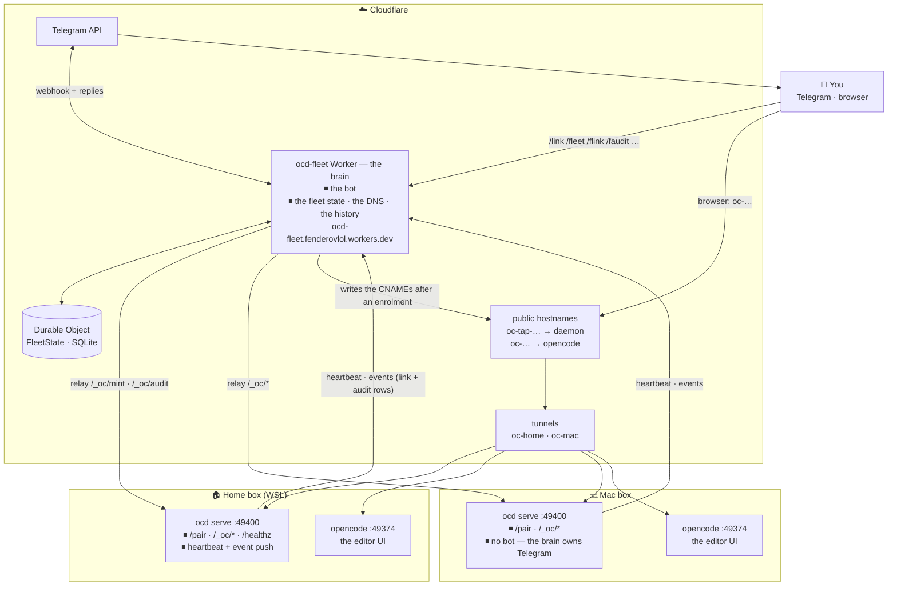
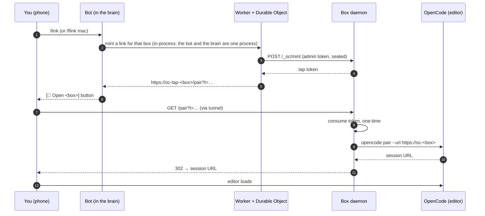
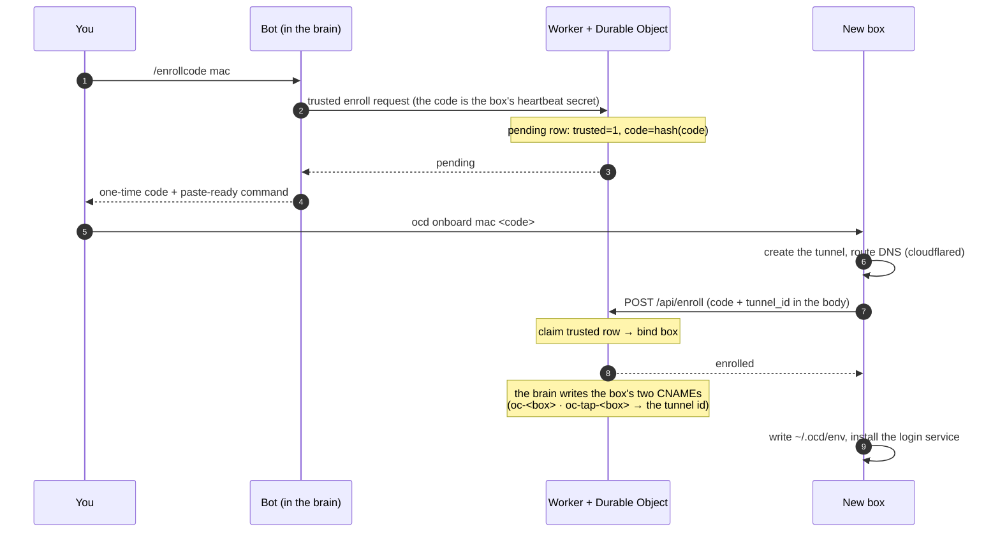
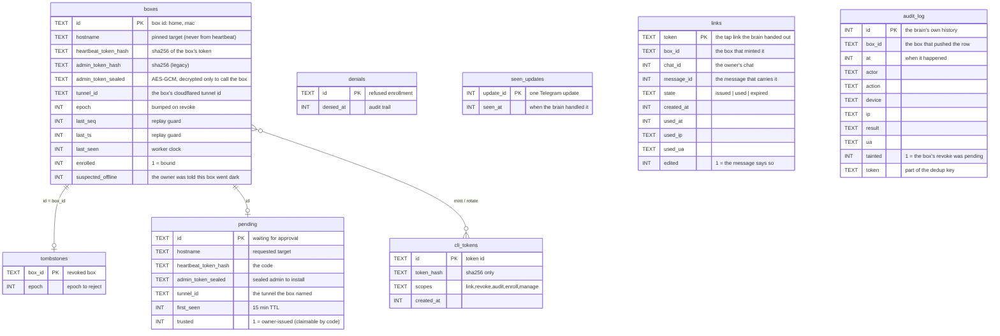

# ocd — architecture

One page for the whole system: what talks to what, what the Worker
actually does, and where every secret lives. Mermaid renders natively in
VS Code (right-click → "Open Preview", or Ctrl+Shift+V).

## 1. Components



**The three things worth internalizing**

1. **The bot lives in the Worker, not on a box.** The brain owns the bot,
   the fleet state, the DNS and the history; a box is a dumb worker —
   pair links, box API, heartbeat, event push. That is why the fleet
   works while a box is down, and why no box hosts a bot.
2. **The Worker is the only shared component, and it holds all state.**
   Boxes know only themselves; the Durable Object knows every box. That
   is what makes `/fleet`, `/flink mac`, revoke-all and the audit trail
   possible. It also *relays* to boxes (`/_oc/mint`, `/_oc/audit`) using
   the box's sealed admin token.
3. **Each box publishes two hostnames pointing at two different
   processes.** `oc-tap-…` → the ocd daemon (pair links, box API),
   `oc-…` → opencode (the editor). The tap link is the handoff: daemon
   → `opencode pair --url` → your browser lands in the editor.

## 2. Session flow (remote login)



## 3. Enroll flow (a new box joins)



## 4. Data model (Worker's Durable Object)



```sql
CREATE TABLE boxes (
  id TEXT PRIMARY KEY, hostname TEXT NOT NULL,
  heartbeat_token_hash TEXT NOT NULL, admin_token_hash TEXT NOT NULL,
  admin_token_sealed TEXT NOT NULL DEFAULT '',
  tunnel_id TEXT NOT NULL DEFAULT '',
  epoch INTEGER NOT NULL DEFAULT 0,
  last_seq INTEGER NOT NULL DEFAULT 0, last_ts INTEGER NOT NULL DEFAULT 0,
  last_seen INTEGER NOT NULL DEFAULT 0, enrolled INTEGER NOT NULL DEFAULT 0,
  suspected_offline INTEGER NOT NULL DEFAULT 0);

CREATE TABLE pending (            -- an enrollment waiting for approval
  id TEXT PRIMARY KEY, hostname TEXT NOT NULL,
  heartbeat_token_hash TEXT NOT NULL, admin_token_sealed TEXT NOT NULL DEFAULT '',
  tunnel_id TEXT NOT NULL DEFAULT '',
  first_seen INTEGER NOT NULL DEFAULT 0, trusted INTEGER NOT NULL DEFAULT 0);

CREATE TABLE tombstones (         -- revoked boxes, blocked until they return
  box_id TEXT PRIMARY KEY, epoch INTEGER NOT NULL DEFAULT 0);

CREATE TABLE denials (            -- refused enrollments, kept for audit
  id TEXT PRIMARY KEY, denied_at INTEGER NOT NULL DEFAULT 0);

CREATE TABLE seen_updates (       -- Telegram update ids, so a retry runs once
  update_id INTEGER PRIMARY KEY, seen_at INTEGER NOT NULL DEFAULT 0);

CREATE TABLE links (              -- every link the brain handed out
  token TEXT PRIMARY KEY, box_id TEXT NOT NULL,
  chat_id INTEGER NOT NULL, message_id INTEGER NOT NULL,
  state TEXT NOT NULL DEFAULT 'issued',
  created_at INTEGER NOT NULL DEFAULT 0,
  used_at INTEGER NOT NULL DEFAULT 0,
  used_ip TEXT NOT NULL DEFAULT '', used_ua TEXT NOT NULL DEFAULT '',
  edited INTEGER NOT NULL DEFAULT 0);

CREATE TABLE audit_log (          -- the fleet's history, pushed by the boxes
  id INTEGER PRIMARY KEY AUTOINCREMENT, box_id TEXT NOT NULL, at INTEGER NOT NULL,
  actor TEXT NOT NULL DEFAULT '', action TEXT NOT NULL DEFAULT '',
  device TEXT NOT NULL DEFAULT '', ip TEXT NOT NULL DEFAULT '',
  result TEXT NOT NULL DEFAULT '', ua TEXT NOT NULL DEFAULT '',
  tainted INTEGER NOT NULL DEFAULT 0, token TEXT NOT NULL DEFAULT '');
CREATE UNIQUE INDEX audit_log_key ON audit_log(box_id, at, action, token);

CREATE TABLE cli_tokens (         -- CLI/API tokens, hashes only
  id TEXT PRIMARY KEY, token_hash TEXT NOT NULL,
  scopes TEXT NOT NULL DEFAULT '', created_at INTEGER NOT NULL DEFAULT 0);
```

**What each table is really for**

- **`boxes`** — the fleet roster. One row per box. `hostname` is *pinned
  at enrollment* and never taken from a heartbeat (that is the SSRF rule:
  the Worker only ever calls the host it enrolled). `heartbeat_token_hash`
  plus `last_seq`/`last_ts` are the replay guard. `admin_token_sealed` is
  the box's admin credential, encrypted at rest and decrypted only in the
  moment of a relay call. `tunnel_id` is the box's cloudflared tunnel id:
  the brain writes the box's DNS from it. `suspected_offline` marks the
  box the owner was already told about — only the sweep clears it, so the
  notice survives until the box answers again.
- **`pending`** — a box that asked to join but is not bound yet.
  `trusted=1` means the request carried the `enroll` scope (the owner
  asked for it in Telegram) → the code alone can claim it. `trusted=0` →
  only the approve link can. `tunnel_id` is the tunnel the box named at
  claim time: the claim builds the box row out of the pending row, so
  the id has to ride along.
- **`tombstones`** — a revoked box stays listed, with the epoch at which
  it was killed. The daemon must come back with a *higher* epoch or the
  Worker keeps refusing it. That is what makes "revoke" mean something
  for a box that is offline.
- **`denials`** — enrollments the owner refused. Tiny table, but it means
  "someone tried to enroll a box and I said no" is recorded, not lost.
- **`seen_updates`** — the Telegram updates the brain already handled.
  Telegram retries a webhook it thinks failed, so a repeated update id
  must not run the command twice — a retried `/link` would mint two
  links.
- **`links`** — every tap link the brain handed out, with the Telegram
  message that carries it. The brain owns that message, so the row is
  how it finds it again to write "✅ logged in" when the box reports the
  link spent. The rows are pruned after 24 hours.
- **`audit_log`** — the fleet's history, ingested from the boxes. The
  boxes push their audit rows to `POST /api/events` and the brain keeps
  them, so `/faudit` answers for a box that is offline or gone for good.
  The unique key (box, at, action, token) makes a re-push a no-op, and
  `tainted` marks the rows that happened while the box's revoke was
  pending.
- **`cli_tokens`** — the tokens the bot and CLI use, stored as SHA-256
  hashes with a scope list. `manage` is the master key; `enroll` is the
  one that marks a pending row trusted.

Box tokens and CLI tokens are stored as hashes, the admin token is
sealed, and the tap codes the box mints *for itself* live in the box's
own store (`~/.ocd/ocd.db`), not in the Worker. The one plaintext the
brain keeps is the token of a link *it* handed out (the `links` table),
for as long as that link may still need its message edited — that is how
it writes "✅ logged in" on the owner's own message. A code the box
minted on its own (its own `/login` links) is not kept by the brain: it
ignores events about links it never handed out.

**The two audit readers, and what each one says**

- The **console** (`GET /api/audit` on the Worker) fans out to the live
  boxes and computes `tainted` at read time: every row of a revoked box
  reads as tainted.
- The **brain** (`/faudit`) answers from its own `audit_log` and marks
  `tainted` at ingest time: only the rows that were pushed while the
  box's revoke was pending.

So the same event reads "revoke pending" in one tool and not in the
other. The brain's rule is the intended one, and the console's answer
shape is a contract the Go client depends on — so the divergence stays
and is written down here instead of being papered over.

The other difference: the console's fan-out used to leave a per-box
error marker for a box it could not read, so a gap in the history was
visibly a gap. The brain's reader has no such marker, so **a lost batch
and "nothing happened" look the same**. That is the price of a history
that survives an offline box, and it is why the box's push keeps a
fingerprint of the row its watermark points at: a trail that was reset
is repaired and offered again instead of silently swallowing rows.

## 5. Hostnames and ports

| Host | Points at | Purpose |
|---|---|---|
| `oc-tap-<box>.buyallmemes.com` | box daemon `:49400` | tap links (`/pair`), box API (`/_oc/*`) |
| `oc-<box>.buyallmemes.com` | opencode `:49374` | the editor UI (the session) |
| `ocd-fleet.fenderovlol.workers.dev` | Worker | fleet API (`/api/*`) |

**The brain owns the DNS — for the boxes it enrols.** After a successful
enrolment it creates (or moves) the box's two CNAMEs — `oc-<box>` and
`oc-tap-<box>` — pointing at the tunnel id the box reported, `proxied:
true`. The write is idempotent: a box that re-enrols with a new tunnel
id gets its records moved, not duplicated. The box's own `ocd onboard`
routes the same names at tunnel-setup time (`cloudflared tunnel route
dns`).

Two limits worth knowing, because the brain is not the writer of record
for every box yet:

- It writes DNS only inside the enrolment, and only for a box that named
  its tunnel. A box that enrolled before the brain knew about tunnels
  carries no tunnel id, so the brain skips it and says so (`skipped: no
  tunnel id recorded for <box> — re-enrol to bind one`). The records
  `cloudflared` wrote are the ones in the zone.
- The UI name it derives is `oc-<box>` — the box's own convention. The
  primary box follows that convention now: its names are
  `oc-home.buyallmemes.com` and `oc-tap-home.buyallmemes.com`, and the
  tunnel behind them is the one named `oc-home`. On the box itself the
  tunnel config (`~/.cloudflared/config.yml`) is the source of truth for
  the hostnames it serves — `ocd repair` reads hostnames from there and
  only fixes ports. The primary box's old names (`oc.buyallmemes.com`
  and `oc-tap.buyallmemes.com`) are gone: they left the tunnel config
  and the DNS when the Mac came on, and every box now answers on the
  one convention.

## 6. Who holds which secret

| Secret | Lives in | Grants |
|---|---|---|
| manage token | your password manager | mint/rotate every other token |
| fleet token | `~/.ocd/env` on the home box | `link`, `revoke`, `audit`, `enroll` |
| heartbeat token | `~/.ocd/env` on each box | that box's heartbeat and its event pushes (bound by the brain) |
| admin token | `~/.ocd/env` on each box; sealed in the brain | the brain calling that box's API |
| Telegram bot token | Worker env `TELEGRAM_BOT_TOKEN` | the bot itself |
| Telegram webhook secret | Worker secret `TELEGRAM_WEBHOOK_SECRET` | the secret Telegram sends back on every update |
| owner chat id | Worker env `TELEGRAM_OWNER_CHAT_ID` | the only chat the bot talks to |
| Cloudflare DNS token | Worker secret `CLOUDFLARE_DNS_TOKEN` | the brain writing the zone's DNS (edit on `buyallmemes.com` only) |
| Cloudflare zone id | `worker/wrangler.toml` `[vars]` | which zone the brain writes |
| tap code | generated by the box, shown in Telegram | one session, one use, 10 min |

## 7. How the code is kept clean

Both halves are held to a **CRAP score of 10**: `complexity² × (1 − coverage)³
+ complexity`. The coverage term is never negative, so a score is never below
the complexity — the bar is therefore mostly a statement about how many paths a
function may have, and the tests are what keep the complex ones honest. A
function of complexity 10 needs 100% coverage to sit at the bar, which is why
the answer to a high score is to split the function, not to chase the coverage.

Two tools, the same formula and the same table: `gocrap` for Go, and `crap`
in `worker/tools/crap/` for TypeScript — the TypeScript twin, which measures
itself.

```bash
# the Go half
go test -coverprofile=coverage.out ./...
gocrap -c coverage.out -max 10 -exclude "*_test.go"

# the brain
cd worker
npm run coverage
npm run crap -- -c coverage/coverage-final.json -max 10

# the tool itself
npm run crap:self
```

Both run in CI, and both fail the build when a function crosses the bar.

### The brain is linted too

The compiler checks the types. The linter checks the shapes the types
cannot see. The brain is linted with `@eslint/js`'s recommended rules,
typescript-eslint's recommended rules, and the **type-aware** ones on top
of them — the type-aware rules are the point: a promise nobody awaits, a
promise handed over where a plain value is expected, a condition the
types prove can never be false, and an `await` of something that is not a
promise are all invisible to `tsc`.

On top of the recommended sets there is a short list of the mistakes this
codebase has actually made: `eqeqeq`, `no-var`, `prefer-const`,
`object-shorthand`, `no-implicit-coercion`, `consistent-type-imports`,
`no-explicit-any` and `no-non-null-assertion`.

`no-console` is off on purpose: in a Worker the console **is** the log,
and the brain logs to it on purpose.

The type-aware rules need the project, so the config turns on
`projectService`: every file is checked against the nearest tsconfig —
`worker/tsconfig.json` for the brain and its tests,
`worker/tools/tsconfig.json` for the tools, which run in node.

The test files are exempt from the two assertion rules
(`no-non-null-assertion`, `no-explicit-any`): a test may assert hard.

```bash
cd worker
npm run lint     # the brain, the tests and the tools
```

It runs in CI — in the `worker` job and in the `tools` job — and it fails
the build on any finding.

### The Go half's dead code is measured too

 `deadcode` (the Go team's) walks the
program from its entry point and reports the functions it never reaches:

```bash
go install golang.org/x/tools/cmd/deadcode@v0.52.0
deadcode ./cmd/ocd
```

The gate runs it **without** `-test`: a function only a test calls is
still dead in the product, and the test that keeps it alive pins a
behaviour the product does not have. `deadcode` exits zero whatever it
finds, so the CI step fails on any output.

**The layers point inward.** The brain's domain modules never import the
Durable Object: the types they share live in `worker/src/boxes.ts`, and
`worker/test/architecture.test.ts` fails the build if one of them reaches
back for `state.ts`. The transport (`worker/src/index.ts`) is the only layer
allowed to know the application.

### The brain's dead code is measured too

The linter sees the shape of the code; it does not see the code nobody
uses. That is knip's job: the files, exports, types and dependencies that
nothing reaches.

The entry points are the ones that actually run, and each one is declared
where it belongs: the Worker's handler (`worker/src/index.ts`, the `main`
of `worker/wrangler.toml`), the tests (`worker/test/*.test.ts` and
`worker/tools/crap/*.test.ts`, read from the two vitest configs) and the
CRAP tool's command line (`worker/tools/crap/cli.ts`, the `crap` script).
knip reads the npm scripts too, so the packages the scripts call —
`vitest`, `typescript` for `tsc`, `wrangler` — count as used although no
module imports them.

The one thing knip cannot know is the platform: `cloudflare:test` and
`cloudflare:workers` are the Workers runtime's own modules, not npm
packages, so `worker/knip.jsonc` tells knip to leave them alone.

```bash
cd worker
npm run knip
```

It runs in CI — in the `worker` job and in the `tools` job — and it fails
the build on any finding: a file nothing imports, an export nothing names,
a type nothing asks for, a dependency nobody uses.

### The components, and the arrows between them

The brain is not clean architecture — no entities with behaviour, no
repositories, no use-case objects. Three rules instead:

1. **The domain names its own ports.** A use case says what it needs
   ("tell the owner this", "point these two names at this tunnel", "mint
   a link on this box") in the domain's own words, and the adapter
   that provides it is wired in from the outside. The needs live with
   the party they are about: `worker/src/owner.ts` (the owner's chat and
   the notifier), `worker/src/box.ts` (the boxes) and
   `worker/src/records.ts` (the DNS records). A port that names the
   adapter's type, its HTTP shape or the client's methods is the adapter
   wearing a port's name.
2. **The adapters implement the ports; the domain never imports an
   adapter.** The port lives in the domain, the implementation lives next
   to the transport it speaks to, and the wiring hands one to the other.
   `worker/src/state.ts` is the wiring: it may import everything, and it
   is the only place the concrete adapters are built.
3. **No cycles.** The import graph is a tree of layers, not a web of
   peers. Two modules that import each other are really one module, or a
   third one is missing. The fix is a module that holds what they share —
   never a re-export that leaves the cycle in place.

`worker/test/architecture.test.ts` enforces two of the three: no domain
module may import an outbound adapter, and the import graph must have no
cycles. The adapters are derived from the tree, never written down: a
module that performs an outbound call is an adapter, whatever it is
called and wherever it lives, so a fifth adapter needs no edit to the
test — the next run of the rule sees it. It also keeps the rule above
it: no module but the transport may import the Durable Object. The first
rule is a judgement — whether a port is named in the domain's words —
and the review is what holds it.

The Go half holds the same line, and the linter keeps it: `cmd/ocd` →
`internal/cli` → the use cases → `internal/store` and `internal/boxagent`.
`depguard` fails the build when an inner package reaches for `internal/cli`
— the command layer is above the domain, and the domain never calls it.
The store is bound to SQLite on purpose: the store *is* the domain's own
model, there is no second implementation coming, and the tests are fast.

## 8. Related documents

- `docs/runbook-home.md` — the WSL box: systemd units, repair, failure triage
- `docs/runbook-mac.md` — onboarding a new box
- `internal/onboard/` — the onboarding flow (enroll, tunnel, repair, launchd)
