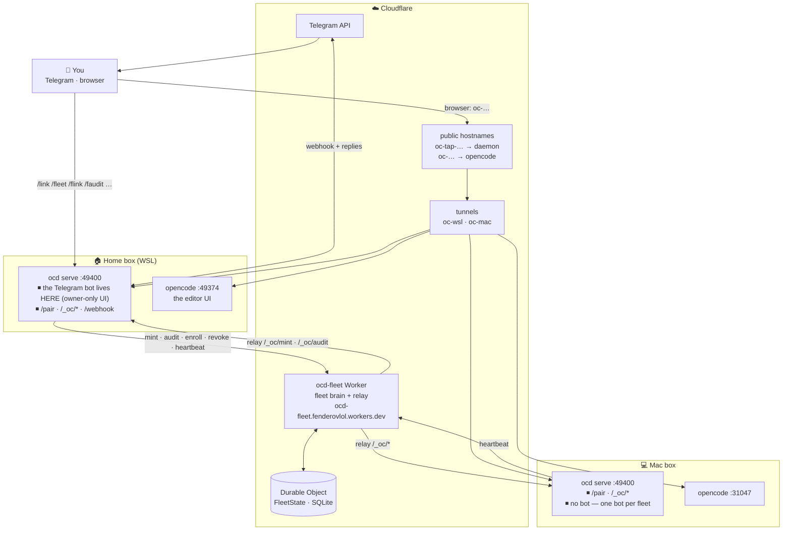
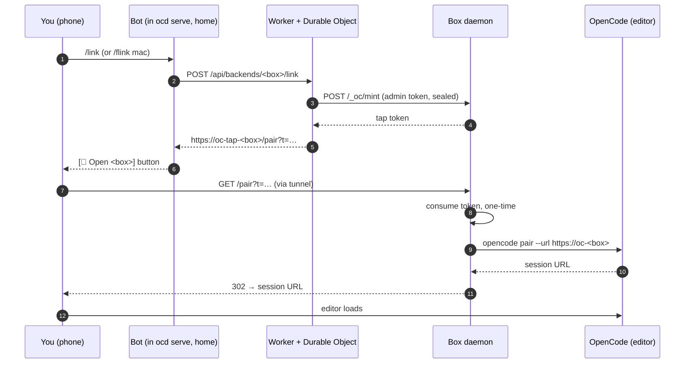
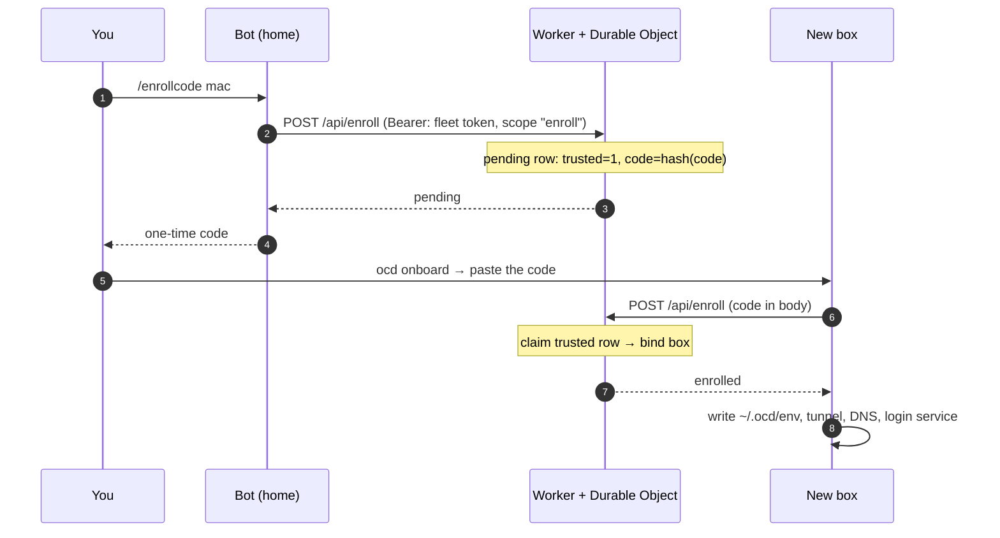
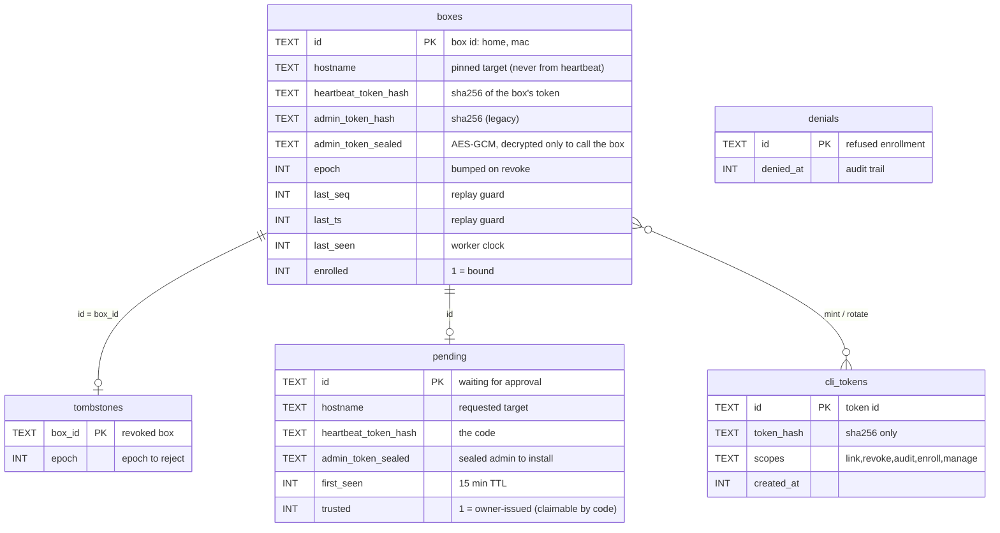

# ocd — architecture

One page for the whole system: what talks to what, what the Worker
actually does, and where every secret lives. Mermaid renders natively in
VS Code (right-click → "Open Preview", or Ctrl+Shift+V).

## 1. Components



**The three things worth internalizing**

1. **The bot is not a service of its own.** It runs *inside* `ocd serve` on
   the home box. That is why the home box is the only one with a bot (a
   second bot on the Mac would fight it over Telegram updates), and why
   "the bot" and "the home box" are the same thing.
2. **The Worker is the only shared component, and it holds all state.**
   Boxes know only themselves; the Durable Object knows every box. That
   is what makes `/fleet`, `/flink mac`, revoke-all and the audit trail
   possible. It also *relays* to boxes (`/_oc/mint`, `/_oc/audit`) using
   the box's sealed admin token.
3. **Each box publishes two hostnames pointing at two different
   processes.** `oc-tap-…` → the ocd daemon (pair links, box API),
   `oc-…` → opencode (the editor). The tap link is the handoff: daemon
   → `opencode pair --url` → your browser lands in the editor.

## 2. Session flow (remote login)



## 3. Enroll flow (a new box joins)



## 4. Data model (Worker's Durable Object)



```sql
CREATE TABLE boxes (
  id TEXT PRIMARY KEY, hostname TEXT NOT NULL,
  heartbeat_token_hash TEXT NOT NULL, admin_token_hash TEXT NOT NULL,
  admin_token_sealed TEXT NOT NULL DEFAULT '',
  epoch INTEGER NOT NULL DEFAULT 0,
  last_seq INTEGER NOT NULL DEFAULT 0, last_ts INTEGER NOT NULL DEFAULT 0,
  last_seen INTEGER NOT NULL DEFAULT 0, enrolled INTEGER NOT NULL DEFAULT 0);

CREATE TABLE pending (            -- an enrollment waiting for approval
  id TEXT PRIMARY KEY, hostname TEXT NOT NULL,
  heartbeat_token_hash TEXT NOT NULL, admin_token_sealed TEXT NOT NULL DEFAULT '',
  first_seen INTEGER NOT NULL DEFAULT 0, trusted INTEGER NOT NULL DEFAULT 0);

CREATE TABLE tombstones (         -- revoked boxes, blocked until they return
  box_id TEXT PRIMARY KEY, epoch INTEGER NOT NULL DEFAULT 0);

CREATE TABLE denials (            -- refused enrollments, kept for audit
  id TEXT PRIMARY KEY, denied_at INTEGER NOT NULL DEFAULT 0);

CREATE TABLE cli_tokens (         -- CLI/API tokens, hashes only
  id TEXT PRIMARY KEY, token_hash TEXT NOT NULL,
  scopes TEXT NOT NULL DEFAULT '', created_at INTEGER NOT NULL DEFAULT 0);
```

**What each table is really for**

- **`boxes`** — the fleet roster. One row per box. `hostname` is *pinned
  at enrollment* and never taken from a heartbeat (that is the SSRF rule:
  the Worker only ever calls the host it enrolled). `heartbeat_token_hash`
  plus `last_seq`/`last_ts` are the replay guard. `admin_token_sealed` is
  the box's admin credential, encrypted at rest and decrypted only in the
  moment of a relay call.
- **`pending`** — a box that asked to join but is not bound yet.
  `trusted=1` means the request carried the `enroll` scope (the owner
  asked for it in Telegram) → the code alone can claim it. `trusted=0` →
  only the approve link can.
- **`tombstones`** — a revoked box stays listed, with the epoch at which
  it was killed. The daemon must come back with a *higher* epoch or the
  Worker keeps refusing it. That is what makes "revoke" mean something
  for a box that is offline.
- **`denials`** — enrollments the owner refused. Tiny table, but it means
  "someone tried to enroll a box and I said no" is recorded, not lost.
- **`cli_tokens`** — the tokens the bot and CLI use, stored as SHA-256
  hashes with a scope list. `manage` is the master key; `enroll` is the
  one that marks a pending row trusted.

No secret is stored in plaintext: box tokens and CLI tokens are hashes,
the admin token is sealed, and the only plaintext secrets in the system
are the tap codes — which live in the *box's* own store
(`~/.ocd/ocd.db`), not in the Worker. That asymmetry is what makes the
tap flow safe: the Worker never learns a tap code, only its hash,
because the code is minted by the box and consumed by the box.

## 5. Hostnames and ports

| Host | Points at | Purpose |
|---|---|---|
| `oc-tap-<box>.buyallmemes.com` | box daemon `:49400` | tap links (`/pair`), box API (`/_oc/*`) |
| `oc-<box>.buyallmemes.com` | opencode `:49374` | the editor UI (the session) |
| `ocd-fleet.fenderovlol.workers.dev` | Worker | fleet API (`/api/*`) |

The primary box does not follow the `oc-<box>` convention: its real
names are `oc.buyallmemes.com` and `oc-tap.buyallmemes.com`. The tunnel
config (`~/.cloudflared/config.yml`) is the source of truth — `ocd repair`
reads hostnames from there and only fixes ports.

## 6. Who holds which secret

| Secret | Lives in | Grants |
|---|---|---|
| manage token | your password manager | mint/rotate every other token |
| fleet token | `~/.ocd/env` on the home box | `link`, `revoke`, `audit`, `enroll` |
| heartbeat token | `~/.ocd/env` on each box | that box's heartbeat (bound by the Worker) |
| admin token | `~/.ocd/env` on each box; sealed in the Worker | the Worker calling that box's API |
| Telegram bot token | `~/.ocd/env` on the home box | the bot itself |
| tap code | generated by the box, shown in Telegram | one session, one use, 15 min |

## 7. Related documents

- `docs/runbook-home.md` — the WSL box: systemd units, repair, failure triage
- `docs/runbook-mac.md` — onboarding a new box
- `internal/onboard/` — the onboarding flow (enroll, tunnel, repair, launchd)
